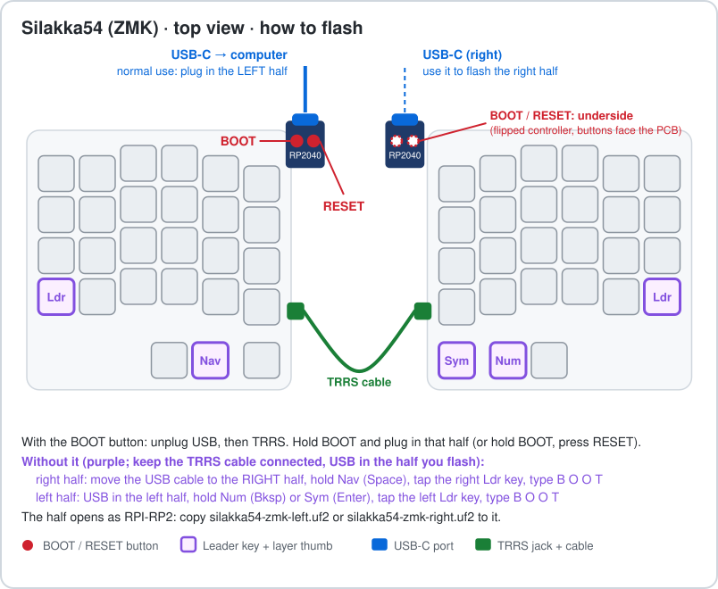

# jellydn's zmk-config

ZMK firmware for my split keyboards, forked from
[urob/zmk-config](https://github.com/urob/zmk-config). The keymap is a port of my Vial layout
([miryoku-silakka54-layout](https://github.com/jellydn/miryoku-silakka54-layout),
[visual reference](https://kb.itman.fyi/index-graphite.html)): Graphite base, GACS home-row mods,
Miryoku-style thumb layers.

**[Download firmware](https://github.com/jellydn/zmk-vial-config/releases/tag/latest)**: every push to
`main` builds the Silakka54 ZMK firmware (left/right) and puts the `.uf2` files, both `.vil` files
and the keymap images in the `latest` release. The Vial builds use stock prebuilt Vial firmware
plus our `.vil`: [Corne v4.1](#corne-v41-qmkvial) and [Silakka54 Vial](#silakka54-qmkvial).

## Keyboards

| Keyboard  | Status    | Build target                             | Notes                                       |
| --------- | --------- | ---------------------------------------- | ------------------------------------------- |
| Silakka54 | supported (current settings untested, see [Test status](#test-status)) | `rpi_pico//zmk` + `silakka54_left/right` | Onboard RP2040, full-duplex wired split, [ZMK Studio](#zmk-studio-silakka54-zmk) on the left half (connect and unlock tested) |
| Corne v4.1 | Vial (stock, untested) | foostan's `crkbd_rev4_1_standard_vial.uf2` + `qmk/corne-v4.1-graphite.vil` | ZMK lacks single-wire (half-duplex) split on RP2040, so it runs Vial |
| Silakka54 | Vial (stock, untested) | Squalius-cephalus' v1.4led [`silakka54_vial_led_LEFT.uf2`](https://github.com/Squalius-cephalus/silakka54/releases/download/v1.4led/silakka54_vial_led_LEFT.uf2) (left half) and [`silakka54_vial_led_RIGHT.uf2`](https://github.com/Squalius-cephalus/silakka54/releases/download/v1.4led/silakka54_vial_led_RIGHT.uf2) (right half) + `qmk/silakka54-graphite.vil` | Same layout as the ZMK build, for Vial users |

## Keymap

- **Base**: Graphite with home-row mods `Gui Alt Ctrl Shift` on `N R T S` and the mirror,
  `Shift Ctrl Alt Gui`, on `H A E I`. They use urob's "timeless" setup without its idle rule; see
  [Home-row mods](#home-row-mods) and the [FAQ](#faq-tap-hold-settings).
- **Thumbs** (left to right): `=`, `Space`/Nav, `Tab`/Mouse, `Enter`/Sym, `Bksp`/Num, `;`.
- **Layers**: Nav (arrows, Home/End, PgUp/PgDn), Mouse (mouse keys, Cmd shortcuts, one-shot Fn),
  Sym (shifted Num), Num (numpad), Fn (F-keys, media). Mouse has `Studio Unlock` on the outer
  bottom-left key for [ZMK Studio](#zmk-studio-silakka54-zmk). `Lock` keeps the current layer on until you
  press it again.
- **Combos** (base layer only):

  | Keys    | Output       | Keys  | Output       |
  | ------- | ------------ | ----- | ------------ |
  | B L     | Esc          | F O   | sticky Meh   |
  | L D     | sticky Gui   | F U   | Esc          |
  | B L D   | Cmd+Q        | O U   | `'`          |
  | L W     | Enter        | . -   | sticky Meh   |
  | D W     | sticky Hyper | Q X   | Cmd+X        |
  | X M     | Cmd+C        |       |              |

- **Graphite shifted pairs** (base layer): Shift+`'` = `_`, Shift+`,` = `?`, Shift+`-` = `"`,
  Shift+`/` = `<`.
- **Leader key** ([urob/zmk-leader-key](https://github.com/urob/zmk-leader-key)): tap `Leader`, then
  type `B O O T` (bootloader) or `R E S E T` (restart). It acts on the half where you tapped
  `Leader`: the right one is on Nav (outer bottom-right key), the left one on Sym and Num (outer
  bottom-left key). See [How to flash](#silakka54-zmk).
- **Mouse keys** match the Vial mouse key settings (linear ramp to 4000 px/s in 600 ms; wheel to
  100 steps/s in 3.2 s).

## Home-row mods

Plain home-row mods decide by time: hold past the tapping term for a mod, release before it for a
letter. Fast rolls then give stray mods, and slow letters give stray taps. urob's
["timeless" setup](https://github.com/urob/zmk-config#timeless-homerow-mods) decides by what you
do instead. This repo uses steps 2, 4 and 5 on every board; steps 1 and 3 are urob's, left out here:

1. **Long tapping term** (urob: 280 ms; here 200 ms). Holding a letter a bit too long does not give
   a mod.
2. **Mod as soon as another key is tapped.** Hold a mod, then press *and release* another key:
   the mod applies at once, without waiting for the tapping term.
3. **Letter at once while typing** (urob: 150 ms; here off). A home-row key pressed within 150 ms
   after a typing key is a letter at once. It removes most misfires on fast rolls, but it also
   blocked home-row Shift right after a letter (see below).
4. **Other hand only.** The mod applies only when the next key is on the other hand or a thumb,
   so same-hand rolls such as `rt` in "start" stay letters.
5. **Same-hand mods still stack.** The hand check waits for the next key's *release*, so
   Ctrl+Shift on one hand works.

A key held past the tapping term on its own also becomes the mod, for a mod with a key on the same
hand, or a mod on its own.

| Step                      | Silakka54 (ZMK, `config/base.keymap`) | Corne and Silakka54 Vial (QMK Settings in the `.vil`) |
| ------------------------- | ------------------------------------- | ---------------------------------------- |
| 1. Tapping term           | 200 ms                                | 200 ms                                   |
| 2. Mod on another tap     | `flavor = "balanced"`                 | Permissive Hold: on                      |
| 3. Letter while typing    | off (no `require-prior-idle-ms`)      | Flow Tap: off                            |
| 4. Other hand only        | `hold-trigger-key-positions`: other hand, all thumbs (and the other number row) | Chordal Hold: on |
| 5. Same-hand mods stack   | `hold-trigger-on-release`             | Chordal Hold: a run of same-hand mods followed by an other-hand key all become mods |
| Quick tap (tap, then hold to repeat) | 200 ms                     | Corne: 0 (off); Silakka54 Vial: 200 ms   |

- All builds have step 3 off, as in the original Corne Vial setup
  ([graphite.vil](https://github.com/jellydn/dotfiles/blob/master/mics/corne/graphite.vil)). With
  it on (Vial Flow Tap or ZMK `require-prior-idle-ms`, both 150 ms), `S`/`H` pressed right after a
  letter typed a letter, so Shift needed a pause first; on the ZMK Silakka54 this showed on
  hardware too. Without it, a fast roll that nests an other-hand key inside a home-row key can give
  a stray mod; the other-hand rule still keeps same-hand rolls as letters.
- In both Vial builds, Chordal Hold counts each thumb key as its own hand. So a home-row mod plus a
  thumb key on the same hand is not a chord: holding `A` and tapping `Bksp` gives `a`, then
  Backspace, not Ctrl+Backspace. In the same way, to use a Nav key on the same hand as `Space`
  (the left mods), hold `Space` for 200 ms (the tapping term) first; a faster press types `Space`
  and that key. The ZMK Silakka54 takes all thumbs as hold-trigger keys instead.
- A thumb layer turns on when the other key is released or after the 200 ms tapping term (Vial's
  QMK Settings owns the per-key hold callbacks, so the thumbs cannot turn on at the press).
- The ZMK combos use the same 150 ms idle rule, so fast rolls such as `bl` type letters, not
  Esc. Vial combos have no idle rule.
- Vial resets Permissive Hold, Chordal Hold and Flow Tap to off on every new build. Load the `.vil`
  after every flash.

## FAQ: tap-hold settings

The Vial values come from Vial's QMK Settings (load the `.vil`; check them under **QMK Settings →
Tap-Hold**). The Corne `.vil` has the same home-row keys and tap-hold settings as the original
[dotfiles graphite.vil](https://github.com/jellydn/dotfiles/blob/master/mics/corne/graphite.vil),
except Quick Tap Term: 0 (the dotfiles have 200 ms).

| Setting | What it does | Why / trade-off | Example |
| --- | --- | --- | --- |
| Tapping term 200 ms | A key held longer than this on its own is a hold. | Fallback only; the rules below decide most presses sooner. Shorter means faster mods but more stray mods. | Rest on `S` 250 ms → Shift. |
| Permissive Hold | Another key pressed *and released* inside a held key makes it a hold at once. | Fast shortcuts (ZMK `balanced`). A sloppy other-hand roll can give a mod; Chordal Hold catches same-hand rolls. | `T`↓ `C`↓ `C`↑ → Ctrl+C. |
| Flow Tap off | Home-row mods are decided by the rules above, also right after a letter. | As in the original `.vil`. At 150 ms, `S`/`H` right after a letter gave a letter, not Shift. | `e`, then `S`↓ `O`↓ `O`↑ → `O`. |
| Chordal Hold | A hold needs the next key on the *other* hand. | Same-hand rolls stay letters. A same-hand mod needs the full 200 ms. A thumb key counts as its own hand. | `S` `T` (same hand) → `st`. |
| Quick Tap Term 0 (Corne) | Off: a tap and then a hold of the same key is always decided by the rules above. | With 200 ms, tapping `A` and then holding it again kept `a` held, so the OS repeated it (`aaa`) instead of Ctrl. Cost: you cannot hold a home-row letter to repeat it. The Silakka54 Vial and ZMK still use 200 ms. | `A`, then `A`↓ `C`↓ `C`↑ → Ctrl+C. |
| Combo term 50 ms | Combo keys must go down within 50 ms. | Chords fire, rolls type. Vial has no idle rule, so a very fast `bl` can still give Esc. | `B`+`L` together → Esc. |
| Combos on every layer | The stock Vial firmware fires combos on every layer (ZMK: base layer only). | `.` + `-` on Num can start the sticky Meh combo. | — |

**Why does my thumb layer wait ~200 ms?** Hold a thumb key and *hold* the next key (for example
`Space` + an arrow): the layer turns on only at the 200 ms term. A tapped next key is instant. Vial's
QMK Settings owns "hold on other key press" for all keys, so it cannot be on for the thumbs only.
Turning it on globally in Vial would also give stray home-row mods.

**Silakka54 (ZMK):** the home-row mods now match Vial, with ZMK names: a 200 ms term, `balanced`
(Permissive Hold), `hold-trigger-key-positions` on the other hand and all thumbs plus
`hold-trigger-on-release` (Chordal Hold), and no `require-prior-idle-ms` (Flow Tap off). urob's
upstream 280 ms term and 150 ms idle rule made home-row Shift wait after a letter. The ZMK combos
keep their own 150 ms idle rule.

## Layout of the repo

| What                               | Where                                |
| ---------------------------------- | ------------------------------------ |
| Layers, HRMs, thumb keys           | `config/base.keymap`                 |
| Combos                             | `config/combos.dtsi`                 |
| Leader sequences                   | `config/leader.dtsi`                 |
| Per-board entry keymap and config  | `config/<board>.keymap`, `.conf`     |
| Silakka54 shield (pins, layout)    | `config/boards/shields/silakka54/`   |
| Build targets                      | `build.yaml`                         |
| Keymap drawing                     | `draw/` (rendered by the Draw workflow or `just draw`) |

`base.keymap` holds every layer once, for the 54-key Silakka54. Another board (such as the Corne)
gets a small `config/<board>.keymap` that defines `ZMK_BASE_LAYER` to drop the number row or add
extra keys, then includes `base.keymap`. Combos and HRM trigger keys use the
[zmk-helpers](https://github.com/urob/zmk-helpers) key labels, so they move with the layout.

## Corne v4.1 (QMK/Vial)

The Corne runs foostan's stock Vial firmware for the Corne v4.1
([`crkbd_rev4_1_standard_vial.uf2`](https://github.com/foostan/kbd_firmware/raw/7e94242f7474761609d7ec16df0872a9785c2ccb/keyboards/crkbd/vial-kb/vial-qmk/.build/crkbd_rev4_1_standard_vial.uf2) from
[foostan/kbd_firmware](https://github.com/foostan/kbd_firmware)). This repo keeps only the setup
for it:

- `qmk/corne-v4.1-graphite.vil`: the full Vial setup: the 6 layers (the Silakka54 layout minus
  the number row), the 11 combos at 50 ms, the 4 Graphite shift overrides, macro M0 and the QMK
  Settings. Load it in Vial after every flash; see [How to flash](#corne-v41-vial).

The extra keys hold ←/→ (EX1) and Play/Pause / Next Track (EX2). The stock firmware has the same
Vial UID, 6 layers and the `split_3x6_3_ex2` layout, so the `.vil` loads as is. Vial keeps combos,
key overrides, macros and QMK Settings in EEPROM, so they come only from the `.vil`.

Compared with the custom Corne firmware this repo built before, the stock firmware:

- fires combos on every layer, so `.` + `-` on Num can start the sticky Meh combo;
- does not take the thumb layer-taps out of Chordal Hold: a home-row mod plus a thumb on the same
  hand stays a letter, and for a Nav key on the same hand as `Space` you hold `Space` for 200 ms
  first (see [Home-row mods](#home-row-mods));
- starts the LEDs on its own default: choose **Typing Heatmap** once under **Lighting** in Vial.

> [!NOTE]
> The stock firmware with this `.vil` is not yet tested on hardware. The earlier hardware test
> (2026-11-21) was of the custom Corne firmware this repo no longer builds.

## Silakka54 (QMK/Vial)

> [!WARNING]
> **The Silakka54 Vial setup is UNTESTED on hardware.** The ZMK build is the main one for this
> board.

A Vial setup of the same layout, next to the ZMK one. It runs the board maker's stock Vial firmware,
Squalius-cephalus' [v1.4led release](https://github.com/Squalius-cephalus/silakka54/releases/tag/v1.4led)
(2026-05-20): [`silakka54_vial_led_LEFT.uf2`](https://github.com/Squalius-cephalus/silakka54/releases/download/v1.4led/silakka54_vial_led_LEFT.uf2) on the left half and [`silakka54_vial_led_RIGHT.uf2`](https://github.com/Squalius-cephalus/silakka54/releases/download/v1.4led/silakka54_vial_led_RIGHT.uf2) on the right half, as the
[maker's wiki](https://github.com/Squalius-cephalus/silakka54/wiki/Firmware-Update) says. This repo
keeps only the setup for it:

- `qmk/silakka54-graphite.vil`: the 6 layers of `config/base.keymap`, the 11 combos at 50 ms, the 4
  Graphite shift overrides, macro M0 (area screenshot) and the QMK Settings (Flow Tap off). Load it
  in Vial after every flash; see [How to flash](#silakka54-vial).

The stock firmware has the same Vial UID, 8 layers (the `.vil` uses 6), the same full-duplex split on
GP0/GP1 and Chordal Hold / Flow Tap in its QMK Settings, so the `.vil` loads as is. Compared with the
custom Silakka54 Vial firmware this repo built before, it:

- fires combos on every layer, so `.` + `-` on Num can start the sticky Meh combo;
- has no bootmagic key on the right half (only the left outer top key); to flash, press BOOT, or
  press RESET twice quickly (double-tap reset);
- lights the controller's LED for the active layer (none on the base layer) and red for Caps Lock or
  Caps Word (v1.4led).

There is no Leader key on Vial.

## ZMK Studio (Silakka54 ZMK)

The left (central) half of the Silakka54 ZMK firmware supports [ZMK Studio](https://zmk.studio/).
Studio changes the keys on each layer and renames layers while the keyboard runs, without a new
flash. The right half has no Studio; it sends its keys to the left half as before.

**Connect**

1. Plug the USB cable into the **left** half. Studio talks to the left half only, over USB (the
   RP2040 has no Bluetooth).
2. Open <https://zmk.studio/> in Chrome or Edge (they have Web Serial; Firefox and Safari do not), or
   use the [desktop app](https://zmk.studio/download). Click **USB** and select the Silakka54.
   On Linux you may need to be in the `dialout` or `uucp` group to open the serial port.
3. Unlock the keyboard (see below). Studio then shows the keymap.

**Unlock.** After you connect, Studio shows **Unlock To Continue** ("your keyboard requires unlocking
before using ZMK Studio"). This is normal. On the left half:

1. Hold `Tab`: the left thumb key nearest the middle (Mouse layer).
2. While you hold it, tap the **outer bottom-left key**: the leftmost key of the bottom row (`F13` on
   the base layer, `Studio Unlock` on Mouse).
3. Let go. The dialog closes and Studio shows the keymap.

If nothing happens, hold `Tab` for about a quarter second before you tap the second key, and check
that the left half runs a firmware with Studio (any build since this feature was added). Studio locks
again when you disconnect and after 10 minutes without use, so unlock again each time you connect.

**What Studio cannot change.** These stay in this repo and need a new flash:

- combos (`config/combos.dtsi`) and their timing;
- hold-tap timings: the home-row mods (200 ms, `balanced`, other-hand trigger, quick tap 200 ms, no
  `require-prior-idle-ms`) and the thumb layer-taps;
- Leader sequences (`config/leader.dtsi`), mouse key speeds and the Graphite shifted pairs;
- the number of layers (6) and the physical layout.

Studio can assign the existing behaviors to any key, also `&hml` and `&hmr`. It cannot assign
`&leader` to a new key: the Leader module gives Studio no parameter data, so Studio refuses it. The
`&leader` keys already in the keymap keep working.

> [!IMPORTANT]
> Studio saves each key you change (and layer names) on the left half. A saved key overrides the
> same key in `config/base.keymap`, also after you flash a new firmware. Changes in `base.keymap` to
> keys you did not change in Studio still take effect. To go back to `base.keymap` for every key,
> click **Restore Stock Settings** in Studio. Studio changes do not show in `draw/silakka54.svg`.

> [!WARNING]
> Keep at least one `Studio Unlock` key. Without one, you cannot unlock Studio again, also not for
> **Restore Stock Settings**, and a new flash keeps the saved keys. To recover, flash ZMK's
> `settings_reset` firmware to the left half: on a branch, add `- board: rpi_pico//zmk` with `shield:
> settings_reset` and `artifact-name: settings-reset` to `build.yaml`, then take `settings-reset.uf2`
> from CI or run `just build settings_reset` (do not merge it: the release expects two `.uf2` files).
> Copy `settings-reset.uf2` to the left half like a normal flash, then flash `silakka54-zmk-left.uf2` again. This erases all Studio changes.

## Test status

Hardware tests are done by hand; CI only checks that each firmware builds. Status on 2026-11-24:

| Build | Firmware file | Current settings | Tested on hardware | Untested |
| --- | --- | --- | --- | --- |
| Silakka54 ZMK | `silakka54-zmk-left.uf2`, `silakka54-zmk-right.uf2` (release) | Home-row mods: 200 ms, `balanced`, other-hand hold-trigger on release, quick tap 200 ms, no `require-prior-idle-ms` (PR #18). Combos: 50 ms, 150 ms idle. Leader `B O O T` / `R E S E T` (PR #4) | 2026-11-22, firmware with urob's 280 ms term and 150 ms idle rule (before PR #18): it types, and home-row Shift waits after a letter (the reason for PR #18). 2026-11-24, ZMK Studio build (PR #25): Studio connects over USB to the left half, `Tab` + outer bottom-left key unlocks it, and Studio shows the keymap | Everything with the PR #18 settings. The Leader key (PR #4 left its hardware checks open). ZMK Studio: edit a key, Restore Stock Settings |
| Silakka54 Vial | Squalius-cephalus' v1.4led [`silakka54_vial_led_LEFT.uf2`](https://github.com/Squalius-cephalus/silakka54/releases/download/v1.4led/silakka54_vial_led_LEFT.uf2) (left half) and [`silakka54_vial_led_RIGHT.uf2`](https://github.com/Squalius-cephalus/silakka54/releases/download/v1.4led/silakka54_vial_led_RIGHT.uf2) (right half) + `silakka54-graphite.vil` | 200 ms, Permissive Hold, Chordal Hold, Flow Tap off, quick tap 200 ms; combos 50 ms on every layer | Nothing | Everything, also flashing and both halves working |
| Corne v4.1 | foostan's [`crkbd_rev4_1_standard_vial.uf2`](https://github.com/foostan/kbd_firmware/raw/7e94242f7474761609d7ec16df0872a9785c2ccb/keyboards/crkbd/vial-kb/vial-qmk/.build/crkbd_rev4_1_standard_vial.uf2) + `corne-v4.1-graphite.vil` | The same QMK Settings as the Silakka54 Vial `.vil` and the dotfiles `.vil`, except quick tap 0 (not 200); combos on every layer; thumbs count as their own hand | Only the old custom firmware (2026-11-21, from `main`, Flow Tap 150 ms): `Space` for Nav after typing, combos, Graphite shift overrides and M0 worked. Later its home-row Shift waited after a letter (fixed by Flow Tap off, PR #16) | Everything on the stock firmware (PR #21) |

**Checklist after a flash** (load the `.vil` first on Vial builds):

1. **Home-row Shift right after a letter:** type `e`, then at once hold `S` and tap `o` → `O`. Do the
   same with `H` and a left-hand letter.
2. **Tap, then hold (Corne):** tap `A`, then at once hold `A` and tap `C` → Ctrl+C, not `aaa`.
   The Silakka54 builds (quick tap 200 ms) still repeat the letter when the second press of `A`
   comes within 200 ms of the first press; a later press gives Ctrl+C.
3. **Fast rolls stay letters:** type words with home-row letters fast (`the`, `start`, `sharp`) → no
   mods.
4. **Thumb layers:** hold `Space` and use Nav arrows (right hand); hold `Bksp` / `Enter` for Num /
   Sym. On Vial, for a Nav key on the left hand, hold `Space` for 200 ms first.
5. **Combos:** `B`+`L` → Esc, `L`+`W` → Enter, `F`+`U` → Esc, `O`+`U` → `'`, `X`+`M` → Cmd+C.
6. **Graphite shift overrides:** Shift+`'` → `_`, Shift+`,` → `?`, Shift+`/` → `<`, Shift+`-` → `"`.
7. **Leader (ZMK only):** left half: hold `Bksp`, tap the outer bottom-left key, type `B O O T` →
   `RPI-RP2` drive. Right half (USB in the right half): hold `Space`, tap the outer bottom-right key,
   type `B O O T`. `R E S E T` restarts the half.
8. **ZMK Studio (Silakka54 ZMK only):** with USB in the left half, connect at <https://zmk.studio/>,
   unlock with `Tab` + the outer bottom-left key, change one key, test it, then click **Restore Stock
   Settings** and check that the key is back.
9. **Removed keys (Corne):** Nav has no Fn key on the left inner home-row key, Mouse has no Caps Lock, and the
   Sym/Num right thumbs do nothing.

## Build

Every push or pull request that touches `config/**` or `build.yaml` builds the firmware in GitHub
Actions (`Build ZMK firmware`, ZMK's official Docker build).

For a local build environment, see [docs/build-env.md](docs/build-env.md) (`just init`, then
`just build silakka54`). The dev shell includes `grpcio-tools`, which the ZMK Studio build of the left
half needs. This repo builds no Vial firmware; the Vial builds use stock `.uf2` files.

## How to flash

The [latest release](https://github.com/jellydn/zmk-vial-config/releases/tag/latest) has every file
built from `main`. Use it instead of the Actions artifacts in step 1 below, unless you want a build
from another branch.

### Silakka54 (ZMK)

**Where the buttons are.** Each half has an
[RP2040-Zero](https://www.waveshare.com/wiki/RP2040-Zero) controller at the inner top corner. Its
BOOT and RESET buttons sit next to its USB-C port. On the original Silakka54 build the right
controller is mounted upside down, so its buttons face the PCB. Press them with a non-metal stick
(the [Silakka54 wiki](https://github.com/Squalius-cephalus/silakka54/wiki/Firmware-Update) has a
3D-printable tool). Check the BOOT/RESET labels printed on your controller.

**Without the BOOT button (Leader key).** Use this once the halves already run this firmware. Keep
the TRRS cable connected and plug the USB cable into the half you want to flash:

- **Right half:** move the USB cable to the right half. Hold `Space` (Nav), tap the outer
  bottom-right key (`Leader`), let go, and type `B O O T`.
- **Left half:** with the USB cable in the left half, hold `Bksp` (Num) or `Enter` (Sym), tap the
  outer bottom-left key (`Leader`), let go, and type `B O O T`.

That half restarts as the `RPI-RP2` drive. Copy its `.uf2` (see step 1) to it; after the right
half, move the USB cable back to the left half. The drive appears only over the USB port of the
half that restarted, because the TRRS cable carries no USB data. `R E S E T` instead of `B O O T`
just restarts that half.

**Steps** (with the BOOT button)

1. In the Actions tab, filter `Build ZMK firmware` by your branch (`main` once merged), open
   the green run for the commit you want, and download the `firmware` artifact. It holds
   `silakka54-zmk-left.uf2` and `silakka54-zmk-right.uf2`.
2. Unplug the USB cable, then unplug the TRRS cable between the halves.
3. Left half: hold BOOT and plug the USB cable into the left half, then let go of BOOT. If it is
   already plugged in, hold BOOT, press RESET, then let go of BOOT.
4. A drive named `RPI-RP2` opens. Copy `silakka54-zmk-left.uf2` to it. The drive closes by itself when
   the flash is done.
5. Unplug the USB cable. Do steps 3 and 4 on the right half with `silakka54-zmk-right.uf2`.
6. With the USB cable unplugged, connect the TRRS cable.
7. Plug the USB cable into the **left** half. The left half is the central; the right half gets
   power and sends its keys through the TRRS cable.

**Troubleshooting**

- One half does not type: flash that half again with its own file. Left and right files are
  different; do not swap them.
- No `RPI-RP2` drive: use a USB cable that carries data, plug in straight to the computer, and try
  BOOT + RESET again.
- Never plug in or unplug the TRRS cable while the USB cable is connected. This can short the
  controllers.

### Silakka54 (Vial)

> [!WARNING]
> UNTESTED on hardware. If it does not work, flash the [ZMK firmware](#silakka54-zmk) again.

The buttons are the same as for ZMK (see the diagram above). With Vial firmware already on a half,
pressing RESET twice quickly also opens the bootloader. Bootmagic works on the left half only: hold
the outer top key (`` ` ``) while you plug in the USB cable.

1. Download Squalius-cephalus' v1.4led files, one for each half, as the
   [maker's wiki](https://github.com/Squalius-cephalus/silakka54/wiki/Firmware-Update) says, and
   `silakka54-graphite.vil` from the [latest release](https://github.com/jellydn/zmk-vial-config/releases/tag/latest):
   - left half: [`silakka54_vial_led_LEFT.uf2`](https://github.com/Squalius-cephalus/silakka54/releases/download/v1.4led/silakka54_vial_led_LEFT.uf2), sha256 `23d905e7780970d9885715744b662262518d0759042b53ac34a132a5d521cb98`
   - right half: [`silakka54_vial_led_RIGHT.uf2`](https://github.com/Squalius-cephalus/silakka54/releases/download/v1.4led/silakka54_vial_led_RIGHT.uf2), sha256 `2fb324cbbd8e6f0487a18da672105aed30b2934a49e0c8317c44e5d2b0f6921c`

   Check a file with `sha256sum <file>` (macOS: `shasum -a 256 <file>`).
2. Unplug the USB cable, then unplug the TRRS cable between the halves.
3. Left half: hold BOOT and plug the USB cable into the left half, then let go. A drive named
   `RPI-RP2` opens. Copy `silakka54_vial_led_LEFT.uf2` to it; the drive closes by itself when the flash
   is done.
4. Unplug the USB cable. Do step 3 on the right half with `silakka54_vial_led_RIGHT.uf2`.
5. With the USB cable unplugged, connect the TRRS cable.
6. Plug the USB cable into the **left** half.
7. Open [Vial](https://get.vial.today) (desktop app or web), choose **File → Load saved layout** and
   pick `silakka54-graphite.vil`. Without this step the keyboard has the stock layout and **no
   combos**, Graphite shift symbols, M0 macro or tap-hold settings. Do it again after every flash.

To go back to ZMK, put each half in the bootloader the same way and copy its ZMK `.uf2`.

### Corne v4.1 (Vial)

**Where the buttons are.** Each half has two small buttons, RESET and BOOT, next to the controller
chip, just below the bottom key of the ring-finger column (the 3rd column from the outer edge). On
the left half RESET is the outer button; on the right half BOOT is the outer one. If a keycap
covers them, press them with a non-metal stick between the keys.

Button positions from foostan's
[Corne v4 PCB picture](https://github.com/foostan/kbd_firmware/assets/736191/05fd9c4b-12c7-4a32-9606-8fea27bfe7b4)
([firmware guide](https://github.com/foostan/crkbd/blob/main/docs/firmware/rev4/firmware_en.md)).

**Steps**

1. Download foostan's Corne v4.1 Vial firmware,
   [`crkbd_rev4_1_standard_vial.uf2`](https://github.com/foostan/kbd_firmware/raw/7e94242f7474761609d7ec16df0872a9785c2ccb/keyboards/crkbd/vial-kb/vial-qmk/.build/crkbd_rev4_1_standard_vial.uf2), and `corne-v4.1-graphite.vil` from the
   [latest release](https://github.com/jellydn/zmk-vial-config/releases/tag/latest). Both halves
   use the same `.uf2`; each half knows its side from the PCB.
2. Unplug the USB cable, then unplug the TRS/TRRS cable between the halves.
3. Left half: hold BOOT and plug the USB cable into the left half, then let go of BOOT. If it is
   already plugged in, hold BOOT, press RESET, then let go of BOOT.
4. A drive named `RPI-RP2` opens. Copy the `.uf2` to it. The drive closes by itself when the flash
   is done.
5. Unplug the USB cable. Do steps 3 and 4 on the right half with the same `.uf2`.
6. With the USB cable unplugged, connect the TRS/TRRS cable (v4.1 takes either).
7. Plug the USB cable into the **left** half. (The right half also works: the half with USB becomes
   the main half.)
8. Open [Vial](https://get.vial.today/), choose **File → Load saved layout** and pick
   `corne-v4.1-graphite.vil`. Without this step the keyboard has foostan's default QWERTY layout
   and no combos, Graphite shift symbols, M0 macro or tap-hold settings. Do it again after every
   flash.
9. Once: under **Lighting** in Vial, choose **Typing Heatmap**.

**Troubleshooting**

- One half does not type: flash that half again.
- Combos, the Graphite shift symbols or the home-row mods do not work: load the `.vil` again. The
  Graphite shift symbols work only on the base layer.
- A half stops working at random: Corne v4 PCBs are sensitive to radio noise, most often from a
  phone ([foostan/crkbd#265](https://github.com/foostan/crkbd/issues/265)). Plug the USB cable in
  again and keep phones more than 30 cm from the keyboard.
- Never plug in or unplug the TRS/TRRS cable while the USB cable is connected. This can damage the
  controllers.
